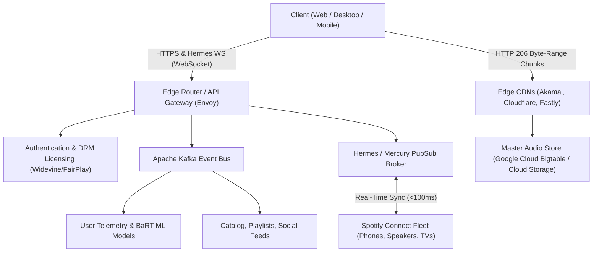

# Spotify Web Player Clone & Real-Time Streaming Architecture

An ultra-modern, high-fidelity Spotify Web Player application built with **React**, **Vite**, and **Vanilla CSS**. This project demonstrates how Spotify functions internally and simulates Spotify's real-time synchronization engine and audio streaming architecture.

---

## 🎧 Live Dev Server

The application dev server runs on:
```bash
npm run dev
# Running on http://127.0.0.1:5173/
```

To build for production:
```bash
npm run build
```

---

## 🧠 Part 1: How Spotify Works Under the Hood

### 1. High-Level Architecture

Spotify operates over **1,200+ event-driven microservices** communicating via **gRPC** and **Apache Kafka**, distributed across Google Cloud Platform (GCP) and multi-tiered Content Delivery Networks (CDNs).



### 2. Audio Streaming & Zero-Latency Playback Pipeline

* **Audio Codecs & Bitrates:**
  * **Desktop / Android:** Ogg Vorbis at 96 kbps (Low), 160 kbps (Normal), and 320 kbps (High/Premium).
  * **iOS / Web Player:** AAC (Advanced Audio Coding) at 128 kbps or 256 kbps.
* **HTTP 206 Byte-Range Chunking:**
  * Rather than transferring complete audio files, Spotify partitions audio tracks into small **128 KB** chunks. The player initiates playback instantly upon receiving chunk 0.
* **Predictive Gapless Pre-Buffering:**
  * 10–15 seconds before the currently playing track finishes, the client silently downloads the header and initial chunks of the next track in the queue, ensuring zero-millisecond audio gaps.
* **Encrypted Media Extensions (EME) & DRM:**
  * Raw audio master files are encrypted. During playback, the browser or native client exchanges an authenticated session token for a decryption key from Spotify's Key Management Service.

### 3. Real-Time Synchronization (Spotify Connect & Hermes Protocol)

* **Hermes / Mercury Protocol:**
  * A lightweight, bidirectional binary messaging protocol operating over persistent **WebSockets**.
* **Device Mesh:**
  * When a user changes tracks, scrubs the timeline, or adjusts volume on their phone, the phone publishes a state delta to Hermes.
  * The broker immediately fans out the update to all active devices in the user's session cluster (desktop client, smart speaker, web player) in under **100 milliseconds**.
* **Friend Activity Feed:**
  * Peer listening updates are broadcast in real-time to mutually followed users, displaying the active track, artist, album, and animated equalizer bars.

### 4. Recommendation Engine: BaRT (Bandits for Recommendations as Treatments)

Spotify curates personalized playlists (like *Discover Weekly* and *Daily Mix*) using three core machine learning techniques:
1. **Collaborative Filtering:** Matrix factorization evaluating billions of user playlists and listening sessions to identify implicit listening patterns.
2. **Convolutional Audio Spectrogram Analysis:** Deep neural networks analyze raw acoustic waveforms for tempo (BPM), danceability, energy, acousticness, and key signature.
3. **Natural Language Processing (NLP):** Web crawlers monitor music blogs, reviews, and social channels to construct semantic cultural profiles for every artist.

---

## 🚀 Part 2: Application Features Built In This Project

1. **State-of-the-Art Spotify UI / UX:**
   * Spotify signature dark palette (`#121212`, `#181818`, `#242424`) with Spotify Green accents (`#1DB954`).
   * Sleek Left Sidebar with Library management, custom playlist creation, and liked songs.
   * Top Navigation Bar with history navigation, live search, and real-time sync indicators.
   * Real-Time Friend Activity Feed on the right panel showing peers listening along with live progress.
2. **Audio Playback Engine & Live Web Audio Visualizer:**
   * Working audio streams across multiple genres (Electronic, Synthwave, Chillhop, Retro).
   * Web Audio API `AudioContext` & `AnalyserNode` frequency spectrum visualizer rendered onto an HTML5 Canvas.
   * Full player controls: Shuffle, Repeat (Off/All/One), Previous, Play/Pause, Next, and interactive time scrubbing with hover tooltip.
3. **Real-Time Synchronized Lyrics:**
   * Karaoke-style lyrics view with dynamic album art blur.
   * Active lyric lines highlight and auto-scroll with click-to-seek functionality.
4. **Spotify Connect Device Switcher:**
   * Simulated device picker allowing switching between Web Player, iPhone, Sonos, and MacBook.
5. **Interactive "How Spotify Works" Architecture Modal:**
   * Deep dive into Microservices, Audio Pipelines, Hermes Sync, and BaRT AI.
   * Client ID testing panel for connecting to the official Spotify Web API.

---

## 🛠 Project Structure

```
Spotify_Clone/
├── public/
├── src/
│   ├── assets/
│   ├── components/
│   │   ├── DevicePickerModal.jsx       # Spotify Connect device modal
│   │   ├── ExpandedPlayerModal.jsx     # Fullscreen player with live Canvas visualizer
│   │   ├── FriendsActivityPanel.jsx    # Real-time desktop friend activity panel
│   │   ├── HomeView.jsx                # Home greeting, quick play, trending charts
│   │   ├── LyricsView.jsx              # Synchronized scrolling karaoke lyrics
│   │   ├── Navbar.jsx                  # Top navigation, live sync indicator, search
│   │   ├── PlayerBar.jsx               # Signature Spotify bottom player bar
│   │   ├── PlaylistView.jsx            # Ambient playlist view with song table & equalizer
│   │   ├── QueueView.jsx               # Live playback queue manager
│   │   ├── SearchView.jsx              # Instant search & genre category tiles
│   │   ├── Sidebar.jsx                 # Left navigation & library playlists
│   │   └── SpotifyArchitectureModal.jsx# Interactive architecture & pipeline guide
│   ├── context/
│   │   └── PlayerContext.jsx           # Audio playback state, Web Audio API, & sync engine
│   ├── data/
│   │   └── mockData.js                 # Curated tracks, audio streams, lyrics & playlists
│   ├── App.css                         # Comprehensive Spotify design system & styling
│   ├── App.jsx                         # Main layout & router
│   ├── index.css                       # Tokens & global styles
│   └── main.jsx                        # React entrypoint
├── index.html
├── package.json
└── vite.config.js
```
